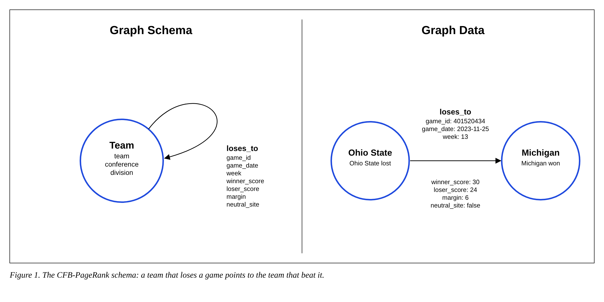

# The Graph Model

Every ranking in this repository comes down to one question: which teams deserve credit for a win? The datasets answer who beat whom. This directory turns that answer into a graph that PageRank can walk.

The code and the files here are owned by Denise Koessler Gosnell. The scripts are licensed under Apache 2.0 and the graph files under CC BY 4.0.

## One Sentence, One Schema

When we model data as a graph, we start from the question we want to ask and write it down as a short sentence. The sentence here is:

```
Team loses_to Team
```

The nouns become vertex labels and the verb becomes the edge label, which gives us one vertex label, `Team`, and one edge label, `loses_to`. The direction of the edge comes from the subject and goes to the object: from the team that lost to the team that won. Figure 1 shows the schema on the left and one real game on the right.



*Figure 1. The CFB-PageRank schema: a team that loses a game points to the team that beat it.*

The edge label starts and ends on the same vertex label, so it is a self-referencing edge label. That is why the schema draws one circle with a loop rather than two circles.

A `Team` vertex carries three properties.

| property | meaning |
| --- | --- |
| `team` | The canonical team name. This is the unique identifier, and it is also what we display. |
| `conference` | The team's conference that season. |
| `division` | `FBS` or `FCS`. Only FBS teams are ranked. |

A `loses_to` edge carries seven properties. The first three are the ones we need to run PageRank one week at a time. The rest are there so that every edge can be checked against the game it came from without guessing.

| property | meaning |
| --- | --- |
| `game_id` | The game's id in the datasets. It makes every edge unique, which matters when two teams play twice. |
| `game_date` | The calendar date of the game, in ISO 8601 form. |
| `week` | The week number from the datasets. The PageRank snapshots step through this property. |
| `winner_score` | The winner's final score. |
| `loser_score` | The loser's final score. |
| `margin` | `winner_score` minus `loser_score`. The weighted PageRank uses this. |
| `neutral_site` | Whether the game was played at a neutral site. |

Naming follows the conventions we use in the book: CamelCase for vertex labels, snake_case for edge labels and property keys.

## Why the Edge Points From the Loser

PageRank passes credit along the direction of the edges. A vertex with many incoming edges from well-connected vertices scores high. In our graph, an incoming edge is a win, so credit flows from the team that lost to the team that beat it. Beat a team that beat a lot of teams and you collect more credit than you would for beating a team nobody else lost to.

The direction has one consequence that is worth saying out loud. A team that has not lost has no outgoing edge. In graph terms it is a dangling vertex. PageRank has a standard way to handle that, and `pagerank/README.md` walks through it.

## Walking Through One Game

Let's read the right side of Figure 1 against the files. In `datasets/2023/games.csv`, the game played on 2023-11-25 between Ohio State and Michigan has the winner Michigan and the loser Ohio State, with a final score of 30 to 24. In `graph_model/2023/edges.csv` that row becomes:

```
source,target,game_id,game_date,week,winner_score,loser_score,margin,neutral_site
Ohio State,Michigan,401520434,2023-11-25,13,30,24,6,false
```

Reading it as a sentence: Ohio State loses_to Michigan. The `source` column is the loser and the `target` column is the winner. Everything after that is a property on the edge. Both teams appear in `vertices.csv`, along with every other team in `teams.csv`, whether or not they have an edge yet.

## Two Games Between the Same Teams

Two teams occasionally play twice in a regular season. We keep both games as two separate edges. The `game_id` property is what makes each edge unique, in the same way that a property has to make each edge unique whenever you want a collection of edges between two vertices instead of a set.

## The Files

| file | what it holds |
| --- | --- |
| `<season>/vertices.csv` | One row per `Team` vertex: `team`, `conference`, `division`. |
| `<season>/edges.csv` | One row per `loses_to` edge: `source`, `target`, then the seven properties above. |
| `<season>/graph.graphml` | The same graph in GraphML, for Gephi, networkx, or any other graph tool. |
| `<season>/VERIFICATION.md` | The translation checks and the point checks for the season. |
| `schema.svg`, `schema.png` | Figure 1. `draw_schema.py` writes the SVG from real data; `render_schema.js` rasterizes it. |

## How We Know the Translation Is Exact

Two scripts answer that question, and `tests/test_graph_model.py` reruns the first one.

`verify_graph.py` compares the graph with the games it came from, eight ways: the edge count equals the game count; every game id appears exactly once among the edges and vice versa; every edge runs from the loser to the winner with the winner's score higher; every edge property equals the matching column in `games.csv`; the vertex set equals the team set; every edge endpoint is a vertex; there are no self-loops; and rebuilding `games.csv` from the edges reproduces every row. It prints a pass or fail line for each one and exits with an error on any failure.

`point_check.py` asks a different question. It draws ten edges per season at random with a fixed seed and compares each one with the box score on NCAA.com, a source that shares no ids with our data. If an error had made it into the datasets and the graph together, this is where it would show. The edges, the values, and the URLs are in each season's `VERIFICATION.md`.

## Rebuilding the Graph

```
python3 graph_model/build_graph.py --season 2024
python3 graph_model/verify_graph.py --season 2024
python3 graph_model/point_check.py --season 2024
```

`make graph` runs the first two for every season. The point check reads the cached pages under `datasets/_raw`, so it needs a run of `datasets/collect.py` first. To redraw the figure, run `python3 graph_model/draw_schema.py`, then `node graph_model/render_schema.js` for the PNG. The second step needs Playwright for Node, which is the one tool beyond the Python standard library that any part of this repository uses.
